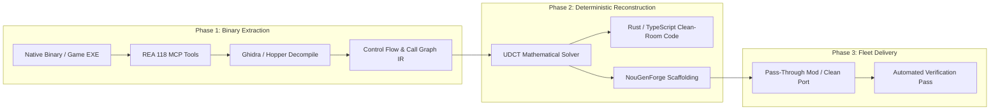

# NouGenMorph: The AI Unlock Has Begun — Game Modding, Binary Decompilation & Autonomous Porting

**Source**: AI Search (`@theAIsearch`)  
**Title**: *"The AI unlock has begun"*  
**URL**: https://youtu.be/h5zkzon0gM4 (`tube:h5zkzon0gM4`)  
**Upload Date**: 2026-10-06 | **Duration**: 14m29s  
**Channel**: AI Search (753K subscribers)  
**Target Fleet Modules**: NouGenForge, REA (`morluto/rea`), UDCT Engine, Reverse Engineering MCP Toolsets  

---

## 1. Tactical Intelligence & Video Breakdown

The video documents a historical inflection point in autonomous software engineering: **agents shifting from writing greenfield web-apps to deconstructing, modding, decompiling, and porting closed-source game engines and native compiled binaries**.

### Core Chapters & Milestones:
1. **0:00 - Intro & The Inflection Point**:
   - AI models (specifically Claude 3.5 Sonnet / Opus class models paired with specialized MCP tools) are now breaching closed binary barriers.
   - Modding, once locked behind years of specialized reverse engineering expertise, is becoming accessible through agentic orchestration.
2. **0:55 - Reverse Engineering Binaries**:
   - Inspecting compiled binaries without source code.
   - Decompilation via Ghidra, IDA Pro, Hopper, and ILSpy.
   - Recovering memory structures, function tables, and logic trees directly into agent context.
3. **3:34 - Pass-Through Modding Architecture**:
   - Intercepting game engine calls in memory or at the API boundary without altering core binaries.
   - Hooking DirectX/Vulkan render passes, game state loops, and network packets.
4. **5:40 - The REA Connection (`morluto/rea`)**:
   - Explicitly cites `morluto/rea` (Reverse Engineer Anything) as the agent-native bridge connecting LLMs directly to decompilation tools (Hopper, Ghidra, CDP).
5. **7:49 - Rebuilding in Rust & Memory Safety**:
   - Taking decompiled C/C++ game routines and cleanly reimplementing them in safe, performant Rust.
   - Eliminating buffer overflows and legacy memory vulnerabilities while maintaining byte-for-byte behavioral parity.
6. **9:06 - Platform Compatibility & Porting Mechanics**:
   - Porting closed console logic (e.g. AnyPS5, PortPS5) and PC binaries to new platforms (macOS, Linux, WebAssembly).
7. **11:50 - Prompting for Decompilation & Reverse Engineering**:
   - Structuring prompts around call graphs, control flow reconstruction, and symbol matching rather than asking models to blindly hallucinate source code.
8. **12:31 - Cracking vs Fair Use Modding**:
   - The double-edged sword of binary recovery: security circumvention versus interoperability, preservation, and gameplay modification.
9. **13:08 - The Autonomous Future**:
   - Game engines become fluid software. Any feature, render technique, or physics mechanic from an existing title can be extracted, analyzed, and synthesized into new projects.

---

## 2. Cited Ecosystem Repositories & Tool Matrix

| Repository | Focus & Domain | Fleet Status |
| :--- | :--- | :--- |
| **`morluto/rea`** | Reverse engineer anything with agents (CLI + MCP + Hopper/Ghidra) | **Absorbed** in `~\Outpost\rea` + MCP registered |
| **`rehan-remade/universal-modder`** | Universal AI game modder harness | Under evaluation |
| **`trevaintdead/ai-game-modding-guides`**| Prompt patterns & workflow guides for AI modding | Sharded into memory |
| **`bethington/ghidra-mcp`** | Ghidra Model Context Protocol bridge | Aligned with REA Ghidra adapter |
| **`HexRaysSA/ida-mcp`** | IDA Pro MCP plugin | Documented |
| **`icsharpcode/ilspy`** | .NET Decompiler engine | Supported via REA managed-code engine |
| **`SamboyCoding/Cpp2IL`** | Unity/Il2Cpp reverse engineering | Critical for Unity game modding |
| **`boykopovar/AnyPS5` / `yuriolive/PortPS5`**| Next-gen console binary emulation & porting | Specialized runtime research |

---

## 3. NouGen Architectural Synthesis & UDCT Alignment

### Invariant 1: No "Vibe" Modding (Evidence-Based Reversal)
- Models must not invent reverse-engineered logic.
- Decompilation must feed directly into formal call graphs and cross-references (`xrefs`) captured in canonical Evidence bundles (`evidence-export`).

### Invariant 2: The Clean-Room Reconstruction Bridge (`REA` $\to$ `NouGenForge`)
- **REA** extracts the behavioral footprint and assembly/CIL evidence.
- **NouGenForge** (`forge_scaffold`) takes the recovered intermediate representation (IR) and deterministically renders the safe Rust or TypeScript reimplementation.

---

## 4. Fleet Action Items
1. ✅ **REA Sharding & Deployment**: Completed with 118 MCP tools and skill.
   - ⚠️ **Status correction (2026-10-12):** the REA MCP was registered in Claude Code (pinned 4.0.1), but relay leg `20261006T134217Z` records **"no Hopper/Ghidra yet"**. No decompiler backend is wired, so Phase 1's `Ghidra / Hopper Decompile` node does not run. On 2026-10-12 the `rea` MCP server also failed to connect (30 s timeout) in a Claude Code session.
2. ✅ **NouGenForge Scaffolding**: Initialized at `~\Outpost\NouGenForge`.
3. 🔄 **Unity/IL2CPP Support**: Benchmark `Cpp2IL` integration with `rea` for automated Unity game asset extraction.
4. 🔲 **Wire a decompiler backend** (Ghidra via `bethington/ghidra-mcp`, or Cutter/rizin) so Phase 1 produces real evidence.
5. 🔲 **Pick a lifter for Phase 1 → Phase 2** from §5 (remill + Rellic is the Apache-2.0 path).

---

## 5. Gap Map: `extremecoders-re/re-list` survey (2026-10-12)

Every link in [re-list](https://github.com/extremecoders-re/re-list) was extracted and checked live on 2026-10-12. Full table, with stars, license, last push, and archive status, is at `analysis/re-list/links.md` and `links.json` in the NouGen checkout; the generator is `analysis/re-list/grep_links.py`. 71 tools (55 GitHub, 16 other): 6 archived, 13 more without a push since before 2023, 2 dead GitHub links, 4 dead other links. The list itself was last updated 2024-04-16.

**What re-list does not cover:** Ghidra, radare2/rizin (only its GUI, Cutter), x64dbg, Frida, ILSpy, Cpp2IL. It is a list of second-tier open-source tools, so it fills gaps around the pipeline in §3, not its core.

| Pipeline stage (§3) | re-list tool | Why it fits | License | Health (2026-10-12) |
| :--- | :--- | :--- | :--- | :--- |
| Phase 1: read / patch the binary file | **LIEF** | Parse and modify PE/ELF/Mach-O; a pass-through mod can patch imports without touching code | Apache-2.0 | ★5.6k, pushed 2026-10-10 |
| Phase 1: decompile (GUI) | **Cutter** | GUI for rizin. re-list's `radareorg/cutter` link is dead; repo now at **`rizinorg/cutter`** | GPL-3.0 | ★20.0k, pushed 2026-09-11 |
| Phase 1 → IR: lift machine code | **remill** | Lifts machine code to LLVM bitcode | Apache-2.0 | ★1.9k, pushed 2026-08-27 |
| Phase 1 → IR: lift machine code | **ANVILL** | Builds on remill to recover functions and types as LLVM bitcode | **AGPL-3.0** | ★383, pushed 2024-09-03 |
| IR → readable C | **Rellic** | LLVM bitcode back to goto-free C, the input a clean-room Rust rewrite needs | Apache-2.0 | ★619, pushed 2026-02-12 |
| IR (alternative) | **miasm** | Python lifter, IR, symbolic execution, emulation in one | GPL-2.0 | ★4.0k, pushed 2026-09-21 |
| IR (alternative) | **BAP** | Lifts 30+ architectures; OCaml | MIT | ★2.3k, pushed 2026-05-07 |
| Behavioral parity test (§1.5) | **Qiling** | Emulate the original routine to record expected outputs for the Rust version | GPL-2.0 | ★6.1k, pushed 2026-09-24 |
| Behavioral parity test | **QBDI** | Instrument the original binary while it runs | see repo | ★1.8k, pushed 2026-09-02 |
| Whole-system trace | **PANDA** | Record and replay whole-system execution | see repo | ★2.8k, pushed 2026-10-09 |
| Symbolic execution | **angr** | Path exploration, CFG recovery (re-list links angr.io; repo `angr/angr`) | BSD-2-Clause | ★9.1k, pushed 2026-10-12 |
| Game state in memory (§1.3) | **PINCE** | Linux memory scanner and editor (Cheat Engine–style) | see repo | ★3.1k, pushed 2026-09-18 |

**Avoid as a base:** `trailofbits/mcsema` and `trailofbits/manticore` are **archived**. `CalebFenton/simplify` (Android) has not been pushed since 2022.

**License note:** ANVILL and MemProcFS are AGPL-3.0, and Qiling, miasm and Cutter are GPL. Running them as separate tools is fine. Linking them into NouGenShards or shipping them inside it would pull their license onto the shipped code. The Apache-2.0 path is LIEF, then remill, then Rellic.

**Scope line (unchanged from §1.8):** the pipeline studies how a binary behaves and rebuilds that behavior in new code. It does not redistribute the game's code or assets, and it does not defeat DRM or anti-cheat. Copied assets and circumvention are where copyright and anti-circumvention law apply, and many game EULAs forbid reverse engineering outright.
